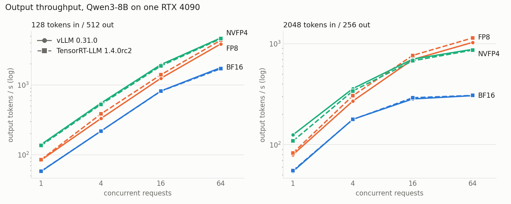
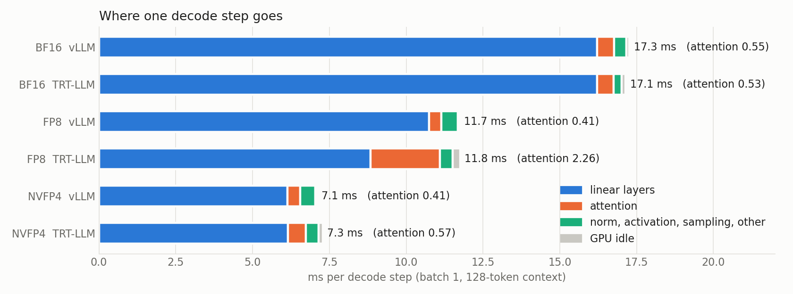
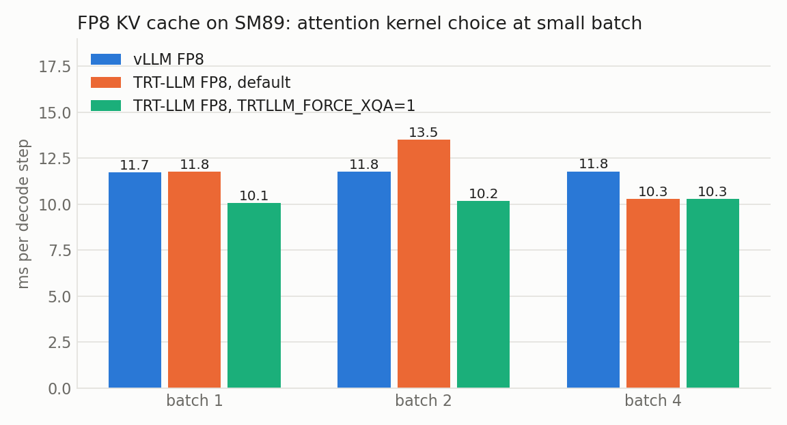

# vLLM vs TensorRT-LLM on one RTX 4090: BF16, FP8 and NVFP4

Benchmarks of Qwen3-8B on a single RTX 4090, using vLLM and TensorRT-LLM with BF16, FP8 and
NVFP4 checkpoints. Both servers run in their official containers and use the same benchmark client.
Measurements cover serving throughput, latency, GSM8K accuracy and CUDA kernel time.

| | |
|---|---|
| Model | Qwen3-8B: `Qwen/Qwen3-8B` (BF16), `nvidia/Qwen3-8B-FP8`, `nvidia/Qwen3-8B-NVFP4` |
| GPU | RTX 4090 (SM89, 24 GB), driver 580.126.09 |
| Engines | vLLM 0.31.0 (`vllm/vllm-openai:v0.31.0`), TensorRT-LLM 1.4.0rc2 (`nvcr.io/nvidia/tensorrt-llm/release:1.4.0rc2`) |
| Client | `vllm bench serve` for both engines, random prompts, fixed seeds, sampling 0.6 / 0.95 / 20 |
| Quality | lm-eval 0.4.13, GSM8K, all 1,319 questions, 5-shot, greedy |
| Profiling | Nsight Systems 2026.5.1, CUDA graphs traced node by node |

## Results at a glance

- BF16: output throughput differs by at most about 3.2% across the tested workloads. At batch 1,
  both engines spend about 94–95% of the decode step in cuBLAS GEMV.
- FP8: TensorRT-LLM delivers about 10–16% higher output throughput at concurrency 4, 16 and 64.
  At batch 1 and 2, its attention kernel selection on SM89 adds substantial overhead;
  forcing XQA reduces step time by up to 25% in the measured cases.
- NVFP4: the shortest batch-1 decode step is 7.1 ms, versus 17.3 ms in BF16. Prefill does not
  see a comparable gain: Ada has no native FP4 tensor cores, so Marlin uses BF16 compute.
- GSM8K: no statistically significant difference from BF16 was detected in the paired tests.
  Individual answers still change, including between runs with identical settings.

## Speed

Median of 3 runs. Left number vLLM, right number TensorRT-LLM.



Output tokens per second:

| in / out | concurrency | BF16 | FP8 | NVFP4 |
|---|---|---|---|---|
| 128 / 512 | 1 | 58 / 58 | 84 / 85 | 140 / 135 |
| 128 / 512 | 4 | 218 / 218 | 330 / 384 | 548 / 525 |
| 128 / 512 | 16 | 818 / 813 | 1,243 / 1,394 | 1,948 / 1,865 |
| 128 / 512 | 64 | 1,763 / 1,707 | 3,858 / 4,351 | 4,694 / 4,577 |
| 2048 / 256 | 1 | 54 / 55 | 80 / 83 | 125 / 109 |
| 2048 / 256 | 4 | 178 / 178 | 271 / 306 | 360 / 341 |
| 2048 / 256 | 16 | 284 / 292 | 698 / 767 | 705 / 678 |
| 2048 / 256 | 64 | 306 / 308 | 1,033 / 1,144 | 881 / 867 |

Time per output token, p50 (ms):

| in / out | concurrency | BF16 | FP8 | NVFP4 |
|---|---|---|---|---|
| 128 / 512 | 1 | 17.3 / 17.1 | 11.9 / 11.7 | 7.1 / 7.4 |
| 128 / 512 | 4 | 18.2 / 18.2 | 12.0 / 10.3 | 7.2 / 7.5 |
| 128 / 512 | 16 | 19.2 / 19.3 | 12.6 / 11.3 | 7.8 / 8.2 |
| 128 / 512 | 64 | 27.1 / 28.2 | 16.0 / 13.9 | 12.7 / 12.7 |
| 2048 / 256 | 1 | 17.6 / 17.4 | 12.1 / 11.7 | 7.2 / 8.4 |
| 2048 / 256 | 4 | 19.9 / 19.3 | 13.2 / 11.4 | 8.7 / 8.5 |
| 2048 / 256 | 16 | 26.3 / 26.4 | 20.7 / 16.9 | 19.4 / 16.6 |
| 2048 / 256 | 64 | 26.3 / 26.5 | 51.1 / 44.3 | 68.9 / 66.5 |

Time to first token, p50 (ms):

| in / out | concurrency | BF16 | FP8 | NVFP4 |
|---|---|---|---|---|
| 128 / 512 | 1 | 27 / 28 | 20 / 26 | 21 / 24 |
| 128 / 512 | 4 | 71 / 71 | 49 / 52 | 60 / 64 |
| 128 / 512 | 16 | 230 / 215 | 156 / 130 | 206 / 211 |
| 128 / 512 | 64 | 857 / 833 | 318 / 426 | 461 / 641 |
| 2048 / 256 | 1 | 217 / 215 | 141 / 115 | 216 / 215 |
| 2048 / 256 | 4 | 647 / 831 | 409 / 446 | 634 / 824 |
| 2048 / 256 | 16 | 7,794 / 6,985 | 538 / 1,027 | 830 / 1,805 |
| 2048 / 256 | 64 | 45,188 / 45,132 | 1,717 / 2,011 | 875 / 1,905 |

Notes:

- vLLM reports KV cache capacities of 20,608 tokens (BF16), 126,256 (FP8) and 170,016 (NVFP4).
  Smaller weights leave more room for KV, and FP8 KV uses half the bytes per token of BF16 KV.
  BF16 can hold about eight full 2,304-token sequences at once (about ten at 2,048 input tokens).
  At concurrency 16 and 64, queueing under KV cache pressure helps explain the multi-second TTFT.
- At 2048 / 256, TensorRT-LLM has higher TTFT in five of the six cells at concurrency 4 and 16.
  Throughput is comparable or higher except for NVFP4. The prefill schedulers differ:
  TensorRT-LLM uses up to 8,192 tokens per step, while vLLM uses 2,048 with chunked prefill.
- Per-run files, p99 values and spreads are in `results/<run>/summary.md`.

## Quality

GSM8K through each engine's own server, started with the settings of the speed runs.

| | BF16 | BF16 again | FP8 | NVFP4 |
|---|---|---|---|---|
| vLLM, strict-match | 87.0% | 87.3% | 86.4% | 85.9% |
| TensorRT-LLM, strict-match | 87.3% | 87.7% | 86.6% | 86.3% |

Each accuracy has a standard error of about 0.9 points. Compared question by question (exact
McNemar test) against BF16 on the same engine:

| | questions that flip | lost / gained | p | identical output text |
|---|---|---|---|---|
| vLLM, BF16 run twice | 18 | 7 / 11 | 0.48 | 71% |
| vLLM, FP8 | 88 | 48 / 40 | 0.46 | 24% |
| vLLM, NVFP4 | 125 | 70 / 55 | 0.21 | 10% |
| TensorRT-LLM, BF16 run twice | 11 | 3 / 8 | 0.23 | 74% |
| TensorRT-LLM, FP8 | 102 | 56 / 46 | 0.37 | 22% |
| TensorRT-LLM, NVFP4 | 124 | 69 / 55 | 0.24 | 9% |
| TensorRT-LLM, FP8 run twice | 60 | 25 / 35 | 0.25 | 44% |
| TensorRT-LLM, NVFP4 run twice | 35 | 16 / 19 | 0.74 | 64% |
| vLLM, FP8 run twice | 53 | 23 / 30 | 0.41 | 41% |
| vLLM, NVFP4 run twice | 52 | 28 / 24 | 0.68 | 48% |

The last four rows compare a quantized run with its own rerun, not with BF16.

- Greedy decoding produced different answers across repeated serving runs. Changes in batch composition
  are a possible source of numerical variation.
- On TensorRT-LLM, reruns changed correctness on 11 questions in BF16, 60 in FP8 and 35 in NVFP4;
  on vLLM, 18, 53 and 52. These counts describe run-to-run variability, not a correction that can
  be subtracted from the BF16-versus-quantized counts.
- Accuracy hides most of this, because gains and losses nearly cancel.
- Output length is unchanged across precisions, and the wrong answers are ordinary arithmetic or
  reasoning slips, not broken text.
- Full tables: [`results/gsm8k/summary.md`](results/gsm8k/summary.md).

## Where a decode step goes

GPU kernel time per decode step at batch 1, from Nsight Systems traces. Tracing changes the time
per token by less than 1%.



| ms per step (vLLM / TensorRT-LLM) | BF16 | FP8 | NVFP4 |
|---|---|---|---|
| whole step | 17.26 / 17.14 | 11.73 / 11.75 | 7.10 / 7.28 |
| linear layers | 16.22 / 16.21 | 10.74 / 8.84 | 6.14 / 6.16 |
| attention | 0.55 / 0.53 | 0.41 / 2.26 | 0.41 / 0.58 |
| everything else, and GPU idle | 0.49 / 0.39 | 0.58 / 0.65 | 0.54 / 0.55 |

How close the linear layers get to the hardware. A decode step reads 15.14 GB of weights in BF16,
8.19 GB in FP8 and 5.15 GB in NVFP4 (the linear layers and the unquantized `lm_head`; the
embedding is a lookup). The tensor-core peaks are 165.2 TFLOPS for BF16 and 330.3 for FP8, which I
have not re-checked against NVIDIA's documentation.

| linear-layer kernel | decode: memory bandwidth (peak 1,008 GB/s) | 2048-token prefill: tensor-core throughput |
|---|---|---|
| BF16, cuBLAS (both engines) | 931 GB/s, 92% | 159 TFLOPS, 96% of the BF16 peak |
| FP8, vLLM (CUTLASS) | 740 GB/s, 73% | 269 TFLOPS, 81% of the FP8 peak |
| FP8, TensorRT-LLM | 921 GB/s, 91% | 328 TFLOPS, 99% of the FP8 peak |
| NVFP4, Marlin (both engines) | 805 GB/s, 80% | 156 TFLOPS, 94% of the BF16 peak |

- The batch-1 linear layers appear bandwidth-bound; the 2,048-token prefill is closer to the
  compute limit. BF16 uses the same cuBLAS kernels on both engines.
- Attention and other work account for roughly 1 ms per step in most runs. TensorRT-LLM FP8 is
  the exception, with substantially higher attention time (see below).
- A rough batch-1 model is weight bytes / effective memory bandwidth, plus time spent outside
  the linear layers. The effective bandwidth in the table ranges from 73% to 92% of peak.
- Side-by-side tables for batch 1 / 2 / 4 / 16 / 64 and context 128 / 2048 / 3900:
  [`results/profile/summary.md`](results/profile/summary.md),
  [`results/profile_sweep/summary.md`](results/profile_sweep/summary.md).

## The FP8 KV attention fallback on SM89

TensorRT-LLM has two attention kernels for the generation phase: XQA (`kernel_mha`) and the older
MMHA (`masked_multihead_attention_kernel`). In the v1.4.0rc2 source:

- `cpp/tensorrt_llm/common/attentionOp.cpp` turns `multi_block_mode` off when the KV cache is
  E4M3 and the GPU is older than SM90. The RTX 4090 is SM89.
- With it off, `DecoderXQARunner::mayHavePerfGain` selects XQA only when
  `num_kv_heads * batch_size * 4.0 >= SM count`. With 8 KV heads and 128 SMs that is batch 4.

The traces match the rule, and it has two effects:

- FP8 checkpoint: below batch 4 the attention runs on MMHA, 2.2 ms per step at batch 1 and
  3.8 ms at batch 2 instead of 0.4 ms. Batch 2 is slower than both batch 1 and batch 4.
- NVFP4 checkpoint (BF16 activations, FP8 KV): MMHA does not support that combination, so XQA
  runs anyway, single-block, and its time grows with context: 0.57 / 1.43 / 2.27 ms per step at
  128 / 2048 / 3900 tokens of context, against 0.41 / 0.54 / 0.68 ms for vLLM's FlashInfer kernel.

Starting the server with `TRTLLM_FORCE_XQA=1` confirms it:



| TensorRT-LLM FP8, ms per decode step | default | `TRTLLM_FORCE_XQA=1` | change |
|---|---|---|---|
| batch 1, context 128 | 11.75 | 10.06 | -14% |
| batch 1, context 2048 | 11.78 | 10.90 | -7% |
| batch 1, context 3900 | 12.01 | 11.72 | -2% |
| batch 2, context 128 | 13.49 | 10.16 | -25% |
| batch 4, context 128 | 10.28 | 10.29 | none |

Forcing XQA reduced step time at batch 1 and 2, with essentially no change at batch 4.
Batch 3 was not measured.

### With the condition removed

I rebuilt the engine from the `v1.4.0rc2` source with the "older than SM90" part of that
condition deleted (one line; build steps and the diff are in
[`results/profile_patched`](results/profile_patched/README.md)) and mounted its libraries into the same
release container.

| ms per decode step | FP8 default | FP8 rebuilt | NVFP4 default | NVFP4 rebuilt |
|---|---|---|---|---|
| batch 1, context 128 | 11.75 | 10.24 | 7.28 | 7.44 |
| batch 1, context 2048 | 11.78 | 10.32 | 8.15 | 7.59 |
| batch 1, context 3900 | 12.01 | 10.51 | 8.98 | 7.75 |
| batch 2, context 128 | 13.49 | 10.35 | 7.36 | 7.51 |
| batch 4, context 128 | 10.28 | 10.54 | 7.41 | 7.67 |
| batch 4, context 2048 | 11.12 | 11.11 | 8.30 | 8.31 |

- The FP8 checkpoint no longer falls back to MMHA at batch 1 and 2 (12-23% faster), and long
  contexts get faster with both checkpoints: at context 3900 one `kernel_mha` call takes 21 µs
  instead of 57.
- Some short-context cells get 2-3.5% slower. The launch grids in the traces show why: the decode CUDA graph
  always launches 16 blocks per sequence, the number the heuristic gives for the 4,096-token maximum,
  whatever the real context is. The steps that run outside the graph use 1 block at context 128 and
  11 at 2048. At context 128 a call takes 13.6 µs with 16 blocks against 10.4 µs with one. Other GPUs that use multi-block attention may incur a similar overhead,
  but this was not tested.
- GSM8K accuracy does not drop. On 1.4.0rc2 the rebuilt engine flips 57–65 questions (FP8) and
  35–36 (NVFP4) against the unmodified one, where two unmodified runs differ on 60 and 35. On
  1.4.0rc4, with the unmodified engine run twice, it is 71–76 against 53 for FP8 and 43–47 against
  38 for NVFP4: somewhat more answers change than in a rerun, gains and losses about equal
  (McNemar p ≥ 0.54).
- One capture per cell, and the rebuilt libraries target SM89 only.

The same captures on the 1.4.0rc4 container, unmodified and rebuilt from the `v1.4.0rc4` source,
give the same picture: every cell is within 0.06 ms of the table above
([`results/profile_rc4`](results/profile_rc4/README.md)). The GSM8K records for that version are in
`results/gsm8k_rc4` and `results/gsm8k_rc4_patched`.

## Reproducing

Run from the repository root with Docker, the NVIDIA container runtime, an idle RTX 4090 (24 GB),
Python 3 with matplotlib, and all three checkpoints in the local Hugging Face cache. The GSM8K run
also needs the dataset cache; see the setup command in [`scripts/quality_gsm8k.sh`](scripts/quality_gsm8k.sh).
The benchmark and profiling scripts check that the GPU is idle before starting.

```bash
scripts/run_all.sh    # standard benchmarks, profiling and plots; about 4 hours
```

What each folder under `results/` holds is listed in [`results/README.md`](results/README.md).

This writes to the existing result directories and can overwrite previous runs. The patched-library
experiment requires a separate source build; see [`results/profile_patched/README.md`](results/profile_patched/README.md).
The individual commands below cover the standard speed and quality runs and default profiles.
`run_all.sh` also runs the extended profiling sweep and forced-XQA test.

```bash
# Speed: 2 workloads x 4 concurrencies x 3 runs, about 18 minutes per engine and precision
scripts/bench_vllm.sh   speed/vllm_bf16    Qwen/Qwen3-8B
scripts/bench_trtllm.sh speed/trtllm_bf16  Qwen/Qwen3-8B          configs/trtllm_bf16.yaml
scripts/bench_vllm.sh   speed/vllm_fp8     nvidia/Qwen3-8B-FP8    --kv-cache-dtype fp8
scripts/bench_trtllm.sh speed/trtllm_fp8   nvidia/Qwen3-8B-FP8    configs/trtllm_fp8.yaml
scripts/bench_vllm.sh   speed/vllm_nvfp4   nvidia/Qwen3-8B-NVFP4  --kv-cache-dtype fp8
scripts/bench_trtllm.sh speed/trtllm_nvfp4 nvidia/Qwen3-8B-NVFP4  configs/trtllm_nvfp4.yaml

scripts/quality_gsm8k.sh        # GSM8K on every engine and precision, plus the BF16 rerun
scripts/profile_all.sh          # Nsight Systems traces and per-step breakdowns
python3 scripts/plot_figures.py # the figures above (needs matplotlib)
```

How the two servers are kept comparable:

- Same client, prompts, seeds and sampling parameters; prefix caching / block reuse off on both.
- Matched KV cache memory target: vLLM runs first with `--gpu-memory-utilization 0.85`, and the
  TensorRT-LLM config is given the same number of bytes (`configs/trtllm_*.yaml` explain each
  setting). For NVFP4 TensorRT-LLM grants 5% less than asked; no measured cell needs the difference.
- Each run records the image digests, the repository commit, how many processes were on the GPU,
  and the CPU load.

The `repo_commit` values in the `env.txt` files are from before the history of this repository was
squashed into one commit.

## Limits

- One GPU, one model, one release of each engine (TensorRT-LLM's is a release candidate).
- Quality is one task, plain completions without the chat template or thinking. The GSM8K tests do not establish equivalent
  accuracy, on this task or on other tasks.
- TensorRT-LLM needs two non-default settings to run the NVFP4 checkpoint on SM89
  (`nvfp4_gemm_config.allowed_backends: [marlin]` and block reuse off); see
  `configs/trtllm_nvfp4.yaml`.
- I could not explain why vLLM's CUTLASS FP8 kernel stays at 73% of bandwidth at small batch, or why
  TensorRT-LLM holds 2.3 GiB more memory outside the KV cache than vLLM with the NVFP4 checkpoint.
- Other CPU jobs ran on the machine during part of the profiling and during the first
  TensorRT-LLM NVFP4 speed run. Throughput in a repeat on a quiet machine was within 0.6%; short-prompt TTFT
  differed, and the reported TTFT values use the quiet run.

## License

[MIT](LICENSE)
